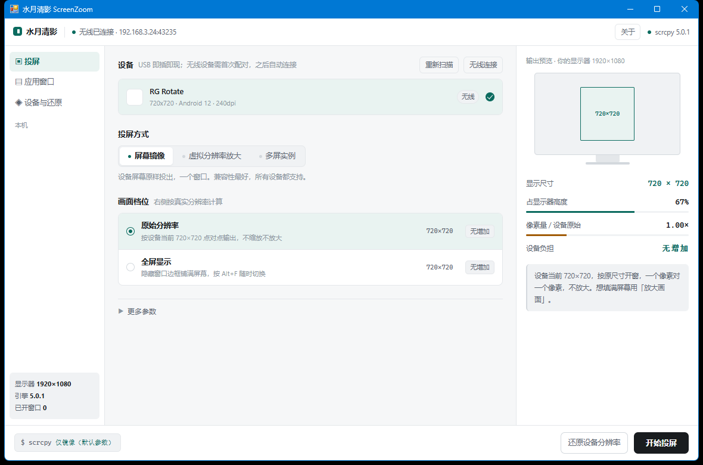
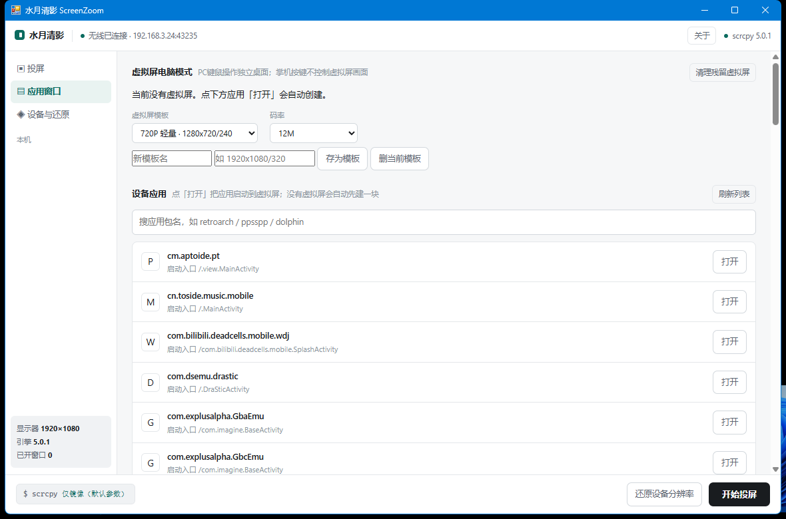
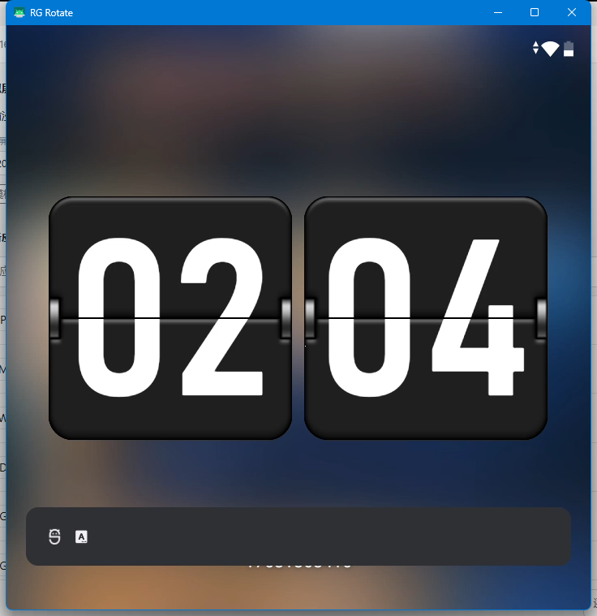

# 水月清影 ScreenZoom

> 把安卓设备的小屏放大上桌：无线投屏 · 高清渲染 · 一机多屏

面向安卓设备（手机、平板、掌机等）的 Windows 投屏工具。基于 [scrcpy](https://github.com/Genymobile/scrcpy) + ADB，把设备侧渲染放大、多虚拟屏实例、参数自动还原、局域网设备发现等能力封装成一套开箱即用的 GUI 工具。

## 功能特性

- **屏幕镜像**：一键镜像设备屏幕，兼容性最好，支持全屏显示
- **高清渲染**：通过 `wm size / wm density` 让设备以更高分辨率重绘画面，投到大屏更清晰（而非简单拉伸）
- **应用投屏**：为每个应用创建独立虚拟显示器与独立窗口，PC 上可并排多个应用；支持 720P / 1080P / 2K 模板与自定义模板
- **设备应用直达**：读取设备已安装应用列表（包名 + 启动入口，本地缓存增量解析），点一下就把应用启动到虚拟屏
- **无线连接**：mDNS 局域网自动发现 ADB over Wi-Fi 设备，首次配对后自动连接，无需记忆 IP/端口
- **参数安全还原**：改过设备分辨率/DPI 后，支持一键还原为设备原始参数，异常断开有兜底
- **虚拟屏生命周期管理**：正常关窗自动释放；残留虚拟屏一键清理
- **中文界面**：开箱即用的中文操作路径与提示文案

## 使用截图

| 投屏设置 | 应用投屏 | 投屏效果 |
| :-: | :-: | :-: |
|  |  |  |

## 快速开始

### 直接使用（推荐）

1. 下载发布页的 `shuiyue-x.y.z.zip`，解压到任意目录（路径里有中文也可以）
2. 双击 `水月清影.exe`

压缩包已包含投屏引擎（scrcpy 与 adb），不用另外下载或安装任何东西，也不用装驱动。

只支持 64 位 Windows（Windows 10 / 11）。界面依赖微软的 WebView2 组件：Windows 11 自带；Windows 10 多数已随 Edge 装过。确实缺失时程序会直接说明并给出官方下载入口，装一次即可。

目录结构：

```
你的目录/
├── 水月清影.exe
├── index.html
├── engine/            # 投屏引擎，随包提供
└── *.dll              # WebView2 组件库，随包提供
```

### 自己构建

仓库已自带编译所需的 WebView2 SDK DLL 和投屏引擎（`engine/`），只需要 .NET Framework 4.x 的 `csc.exe`（Windows 自带，不用装 SDK）。

```powershell
# 在项目根目录执行
.\build.ps1
```

编译产物为 `水月清影.exe`。运行时引擎只认 exe 同目录的 `engine/`（里面需有 `scrcpy.exe`、`adb.exe`），所以整个目录一起搬走即可；升级 scrcpy 时只替换 `engine/`。

`app.manifest` 会被 `build.ps1` 通过 `/win32manifest` 嵌入 exe，声明 PerMonitorV2 高 DPI 感知；删掉它会导致进程退回 DPI unaware，Windows 按 96dpi 渲染后整窗拉伸，界面文字发糊。

界面发糊时先看 `debug.log` 里的 `UI 自检` 行，它一次给出感知模式、窗口真实 DPI、当前尺寸、按该 DPI 应有的尺寸、以及落在哪块屏。`感知=Unaware(清单失效!)` 说明清单没生效；`尺寸` 与 `期望` 不一致说明缩放换算有问题。多屏不同缩放时窗口若落在非主屏，首次显示会自动按所在屏校正（`UI 按所在屏缩放校正`），拖动跨屏会记 `UI 跨屏`。

## 工作原理

- **画面传输**：scrcpy 在设备端推送临时 server，捕获屏幕/虚拟显示器 → 硬编码 H.264/H.265 → 通过 ADB TCP 隧道回传 → 本机 FFmpeg 解码渲染
- **高清渲染**：投屏前用 `wm size` / `wm density` 改设备渲染分辨率，让系统以更高分辨率重绘 UI，画面细节真正提升；投屏结束后自动还原
- **应用投屏**：`scrcpy --new-display` 创建独立虚拟显示器，配合 `--start-app` 把指定应用启动到该虚拟屏；支持多窗口并行
- **无线连接**：扫描局域网 ADB 无线调试服务（mDNS），自动配对、自动发现连接端口

## 已知限制

- 普通第三方 APP 无法静默打开设备的「无线调试」，仍需要用户按系统引导手动开启一次
- 部分应用强制绑定物理主屏，无法在虚拟屏中启动（会自动切回主屏或黑屏）
- 部分安卓系统不支持 `am start --display-id` 追加启动，此时每次「打开」会新开一块虚拟屏
- 个别系统不支持 `display remove` 命令，异常残留的虚拟屏需重启设备清除（正常关窗会自动释放）

## 支持与打赏

开发不易，如果这个软件对你有帮助，可以随手支持一下，codex的额度真的不够用啦，哭哭~

打赏完全自愿，不影响任何功能使用。


## 许可证

本项目基于 **GPL-3.0** 协议开源，详见 [LICENSE](LICENSE)。

依赖组件与协议：

| 组件 | 协议 |
|---|---|
| [scrcpy](https://github.com/Genymobile/scrcpy) | Apache-2.0 |
| [Android Platform Tools / adb](https://developer.android.com/tools/releases/platform-tools) | Apache-2.0 |
| [FFmpeg](https://ffmpeg.org/)（LGPL 构建，动态链接） | LGPL-2.1+ |
| [SDL3](https://github.com/libsdl-org/SDL) | Zlib |
| [libusb](https://github.com/libusb/libusb) | LGPL-2.1 |
| [WebView2 SDK](https://developer.microsoft.com/microsoft-edge/webview2/) | BSD 风格（微软） |
| WebView2 运行时 | 微软专有，由系统提供，不随包分发 |

第三方许可证原文与再分发说明见 [THIRD-PARTY-NOTICES.md](THIRD-PARTY-NOTICES.md)。
